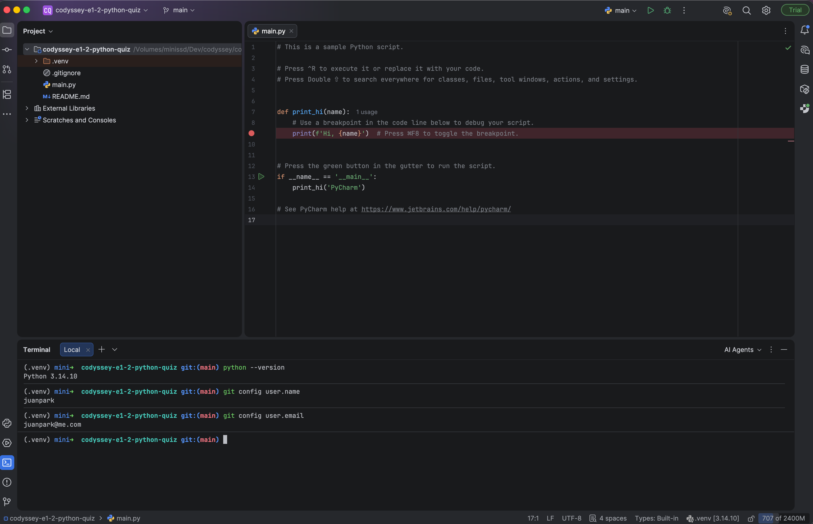
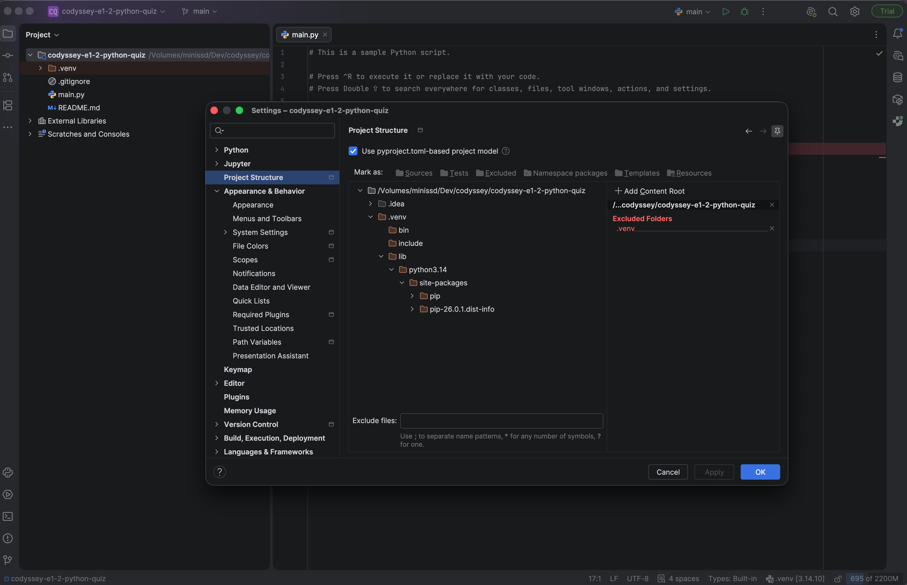
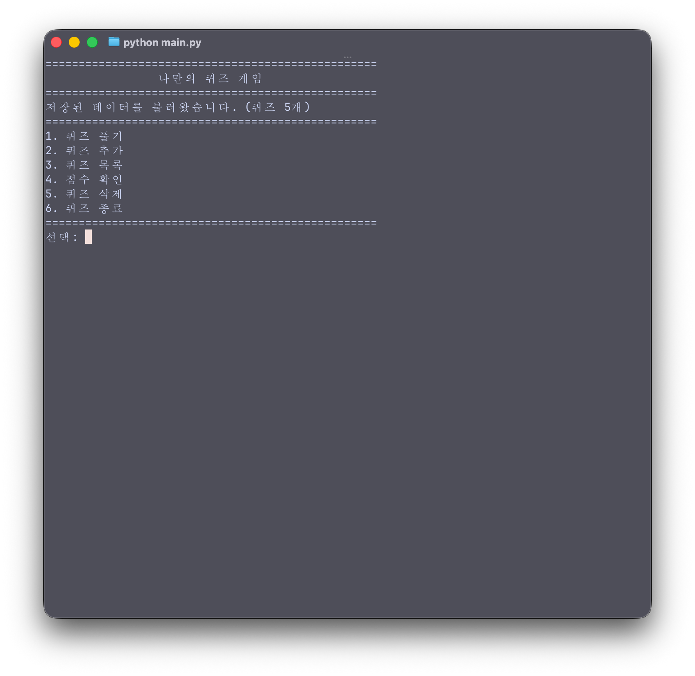
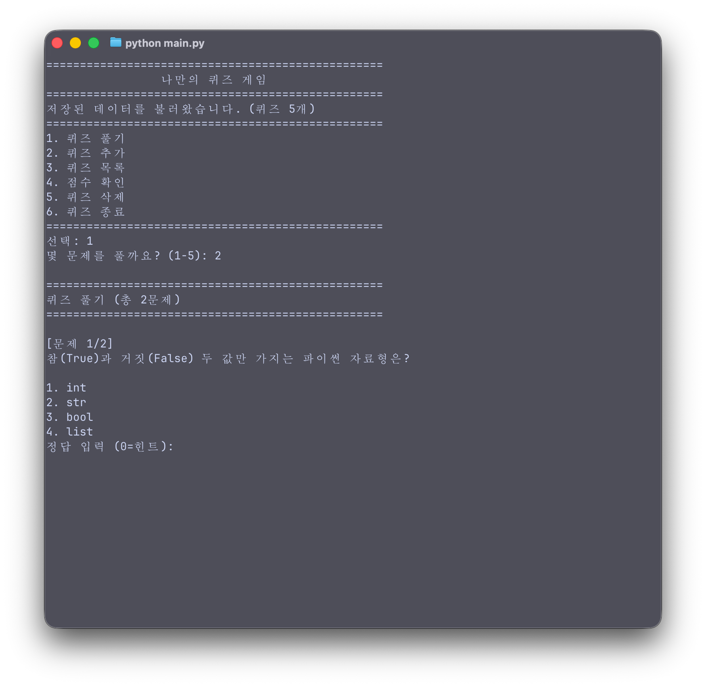
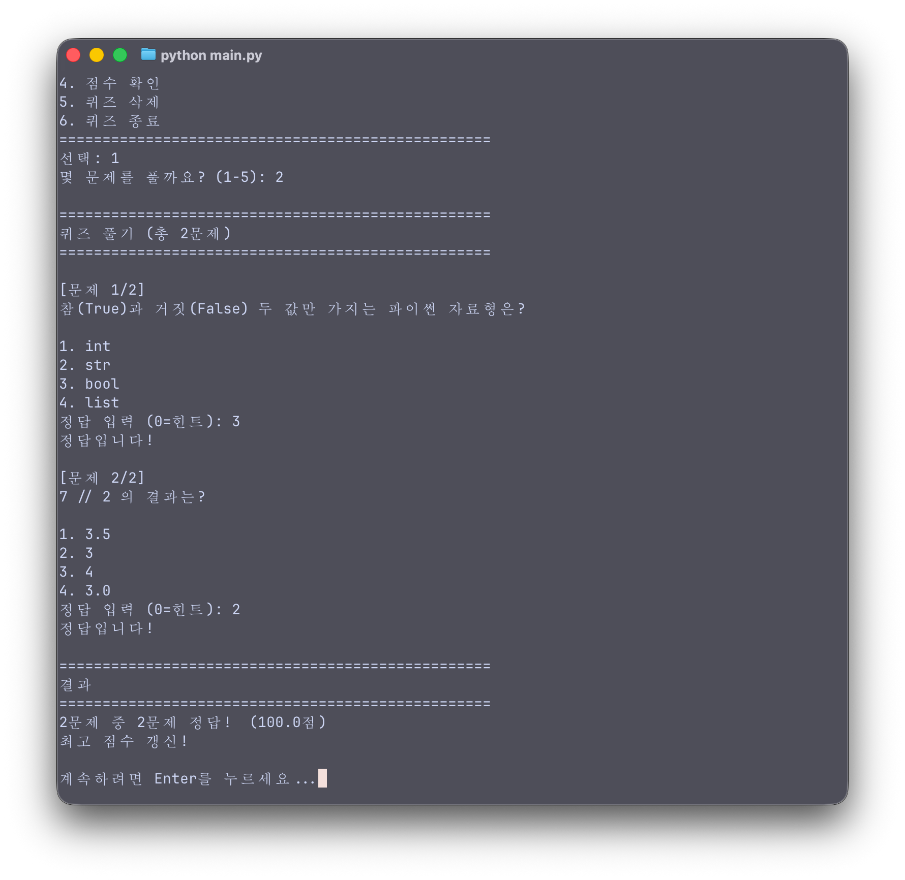
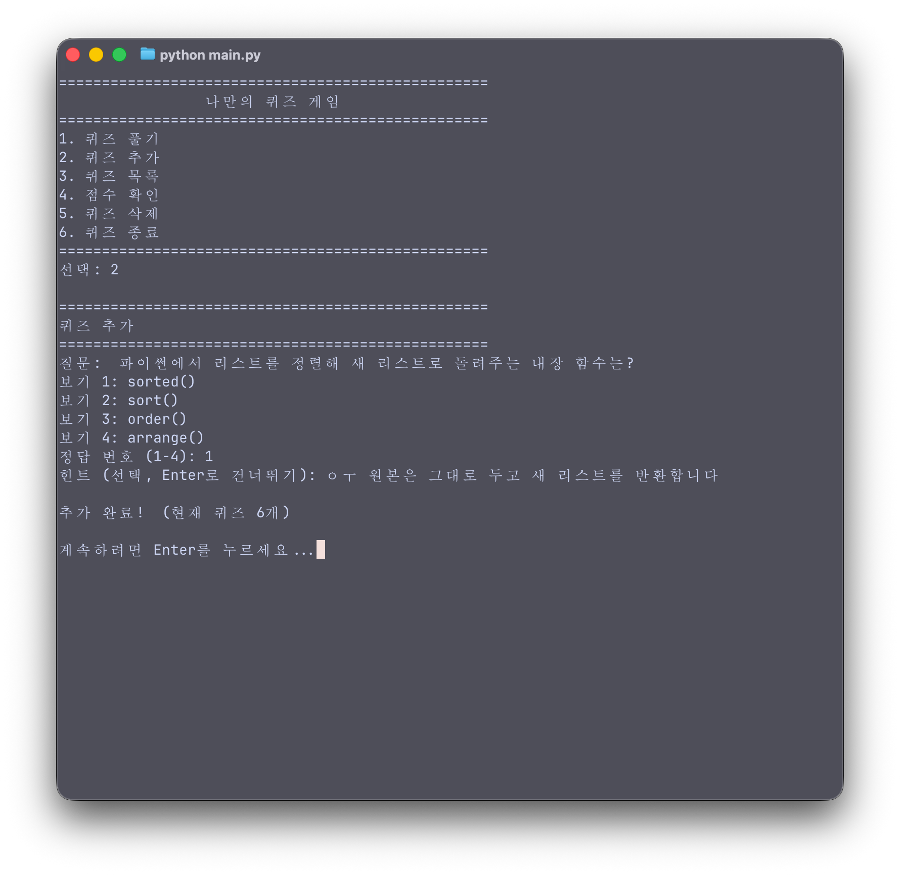
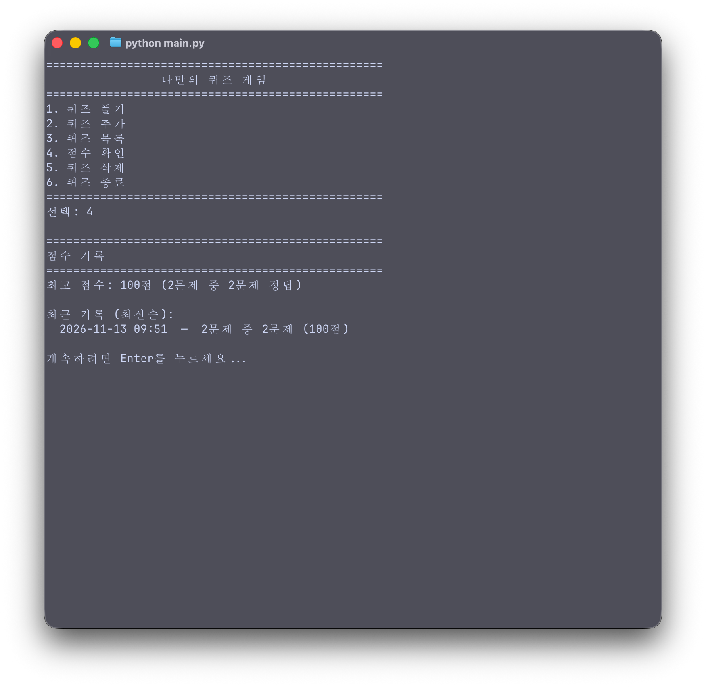
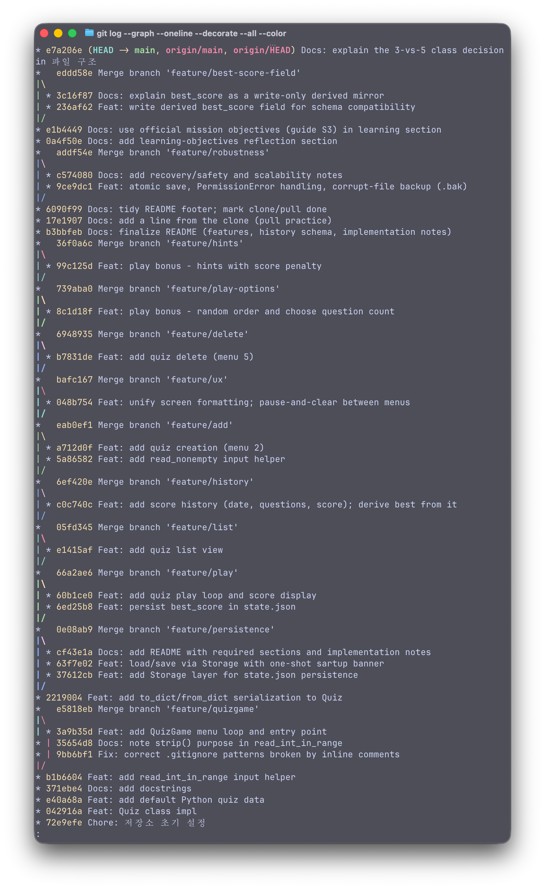

# 나만의 퀴즈 게임 (Python Quiz Game)

경남 코디세이 AI 올인원 — **Mission E1-2**. 터미널에서 동작하는 메뉴 기반 파이썬 퀴즈 게임입니다.

> 이 README는 리뷰어와 작성자(본인) 모두에게 교육적으로 도움이 되도록, 요구 항목(개요·주제·실행·기능·구조·데이터 파일) 뒤에 **구현 노트**를 두어 작업하며 어렵거나 흥미로웠던 부분을 자세히 설명합니다.

---

## 1. 프로젝트 개요

하나의 콘솔 프로그램 안에서 다음을 통합 연습하는 것이 목표입니다.

- **파이썬 입문 문법** — f-string, 슬라이싱, `match`/`case`, 컴프리헨션 등
- **객체지향(OOP)** — 2개 이상의 클래스, 역할 분리, 대체 생성자
- **파일 입출력 & 영속성** — JSON으로 상태를 저장해 **재시작 후에도 데이터 유지**
- **철저한 예외 처리** — 잘못된 입력·없는/손상된 파일·`Ctrl+C` 종료를 모두 우아하게 처리
- **Git 워크플로우** — 의미 있는 커밋, 브랜치 생성·병합, clone/pull

메뉴(풀기 / 추가 / 목록 / 점수 / 삭제 / 종료)를 반복 표시하며, 사용자가 만든 퀴즈와 플레이 기록은 `state.json`에 저장됩니다.

---

## 2. 퀴즈 주제와 선정 이유

**주제: Python 그 자체.**

파이썬을 배우는 중에 **파이썬에 대한 퀴즈**를 낸다는 점이 의도된 아이러니입니다. 동시에 실용적인 이유가 있습니다 — 입문자가 자주 헷갈리는 지점을 문제로 만들면 **복습 효과**가 큽니다. 기본 문제들은 바로 그런 "함정"을 다룹니다.

| 문제 | 노리는 개념 |
|---|---|
| `bool` 자료형 | 참/거짓 두 값만 갖는 타입 |
| `nums[1]` | 인덱스는 0부터 |
| `'python'[1:4]` | 슬라이싱: 시작 포함, 끝 제외 |
| `7 // 2` | 정수 나눗셈(버림) |
| `b = a; b.append(4)` | 참조(aliasing) — 복사가 아님 |

---

## 3. 실행 방법

```bash
python main.py
```

- **Python 3.10 이상** 필요 (`match`/`case` 문 사용).
- **외부 라이브러리 없음** — 표준 라이브러리(stdlib)만 사용합니다.
- 데이터는 프로젝트 루트의 **`state.json`** (UTF-8)에 저장됩니다.
- 처음 실행하거나 새로 `clone` 한 직후에는 `state.json`이 없으므로 **기본 문제 5개**로 시작합니다.

> **참고 — Python 버전:** 시스템 기본 `python3`가 3.9 이하이면 `match`/`case`에서 오류가 납니다. 3.10 이상(예: 프로젝트 `.venv`)으로 실행하세요.

### 개발 환경




---

## 4. 기능 목록

| 메뉴 | 기능 |
|---|---|
| 1. 퀴즈 풀기 | 문제 수를 고르고(보너스) 랜덤 순서로(보너스) 풀기. 힌트 열람 가능(점수 차감, 보너스) |
| 2. 퀴즈 추가 | 질문·보기 4개·정답·힌트를 입력해 새 퀴즈 등록 |
| 3. 퀴즈 목록 | 등록된 퀴즈 목록 보기 |
| 4. 점수 확인 | 최고 점수 + 최근 플레이 기록 보기 |
| 5. 퀴즈 삭제 | 번호로 퀴즈 삭제(0=취소, 보너스) |
| 6. 퀴즈 종료 | 저장 후 종료 |

**보너스 (모두 구현):** 랜덤 출제 · 문제 수 선택 · 힌트(점수 −10점) · 퀴즈 삭제 · 점수 히스토리.

**공통 입력/예외 처리:** 숫자가 아닌 입력·범위 밖·빈 입력은 메시지와 함께 다시 묻고, `Ctrl+C`/`EOF`는 traceback 없이 우아하게 종료합니다. 각 메뉴 작업 후에는 **Enter로 잠시 멈춘 뒤** 화면을 지우고 메뉴를 위에서 다시 그립니다.

### 실행 화면

**① 메인 메뉴** — 시작 시 저장 데이터를 불러오고(배너), 제목은 한글 폭을 계산해 정확히 가운데 정렬(§7.10).



**② 퀴즈 풀기** — 문제 수 선택(보너스)·랜덤 출제(보너스)·힌트(`0=힌트`, 보너스)가 한 화면에 보입니다.



**③ 채점 결과** — 정답 수 → 백분율 점수, 이전 최고점과 비교해 `최고 점수 갱신!` 표시.



**④ 퀴즈 추가** — 질문·보기 4개·정답·힌트를 입력하면 즉시 저장(현재 퀴즈 수 갱신).



**⑤ 점수 확인** — 최고 점수와 날짜별 최근 기록(보너스). 재시작 후에도 유지됩니다.



---

## 5. 파일 구조

한 클래스 = 한 파일(flat module). 폴더 계층은 두지 않되, **역할은 논리적으로 분리**합니다. (자바의 깊은 패키지 폴더와 대비 — 물리적 폴더가 아니라 논리적 계층.)

| 파일 | 클래스/역할 | 비유 (Spring) |
|---|---|---|
| `quiz.py` | `Quiz` — 문제 1개(질문·보기·정답·힌트) + 자기 직렬화(`to_dict`/`from_dict`) | Entity |
| `default_data.py` | `default_quizzes()` — 하드코딩 기본 퀴즈(없거나 손상 시 씨앗) | 시드 데이터 |
| `input_utils.py` | `read_int_in_range()`, `read_nonempty()` — 입력 검증 헬퍼 | 입력 유효성 검사 |
| `storage.py` | `Storage` — `state.json` 읽기/쓰기(**이 파일만 디스크를 만짐**) | DAO / 영속 계층 |
| `quiz_game.py` | `QuizGame` — 메뉴 루프 오케스트레이션, 사용자 대면 출력 | Service / Controller |
| `main.py` | 진입점 (`QuizGame().run()`) | main |

### 왜 클래스가 3개인가 — 설계 때는 5개를 생각했다

처음 설계에서는 클래스를 **5개**로 잡았습니다: `Quiz`, `Storage`, `QuizGame` 에 더해 —

- **`QuizBank`** — 퀴즈를 담고 추가·삭제·목록을 담당
- **`ScoreBoard`** — 점수와 플레이 기록을 추적

하지만 `QuizBank`·`ScoreBoard`를 **`QuizGame` 안으로 흡수**했습니다. 두 역할이 자기만의 상태를 거의 갖지 않았기 때문입니다. 예를 들어 `QuizBank`가 관리할 상태는 퀴즈 리스트 하나뿐인데, 그 리스트는 이미 `QuizGame`이 들고 있었습니다. 별도 클래스로 떼어내면 **구조가 아니라 마찰**(두 객체 사이에 리스트를 넘기고 되돌려받는 보일러플레이트)만 늘어납니다.

그래도 **두 역할은 사라지지 않고** `QuizGame`의 메서드로 살아 있습니다 — 그래서 코드는 3개 클래스지만 머릿속 모델은 여전히 5칸입니다:

| 흡수된 역할 | 지금 사는 곳 |
|---|---|
| QuizBank (퀴즈 관리) | `add_quiz()` · `delete_quiz()` · `list_quizzes()` · `self.quizzes` |
| ScoreBoard (점수 추적) | `best_run()` · `_record_pct()` · `show_score()` · `self.history` |

**배운 것:** 클래스는 "전부 클래스로 만든다"고 해서 좋은 게 아닙니다. **함께 묶이는 상태 + 행동을 진짜로 소유할 때** 클래스가 제 몫을 합니다. `QuizBank`는 소유할 상태가 없었으므로 클래스가 될 자격이 없었습니다. "이건 클래스로 뺄 필요가 없다"는 판단이, "일단 클래스로 만들자"보다 한 단계 높은 설계 감각입니다. (미션 요구는 2개 이상 — 3개로 충족하되, 억지로 5개로 부풀리지 않았습니다.)

---

## 6. 데이터 파일 설명 — `state.json`

| 항목 | 내용 |
|---|---|
| **경로** | 프로젝트 루트 `state.json` (실행 위치 기준) |
| **인코딩** | UTF-8 (`ensure_ascii=False` → 한글이 `\uXXXX`가 아니라 그대로 저장) |
| **역할** | 런타임 상태(사용자가 추가한 퀴즈 + 플레이 기록)를 영속화해 **재시작 후에도 유지** |
| **버전 관리** | `.gitignore` 처리 — 새로 `clone` 하면 파일이 없어 "없음 → 기본값" 경로가 자연히 실행됨 |

**스키마 (최상위는 객체):**

```json
{
  "quizzes": [
    {
      "question": "7 // 2 의 결과는?",
      "choices": ["3.5", "3", "4", "3.0"],
      "answer": 2,
      "hint": "// 는 몫만 남기는 정수 나눗셈(버림)."
    }
  ],
  "history": [
    { "datetime": "2026-11-13 14:30", "correct": 4, "total": 5, "hints": 1 }
  ],
  "best_score": 80
}
```

- **`quizzes`** — 퀴즈 배열. `answer`는 **1~4(사람 기준)** 로 저장, `choices[answer-1]`이 정답(유일한 `-1`은 보기 인덱싱).
- **`history`** — 플레이 기록 배열(날짜/시간·맞힌 수·총 문제 수·힌트 횟수). **진실의 원천(source of truth).**
- **`best_score`** — history에서 **매 저장 시 계산해 함께 기록**하는 파생 미러. 로드 때는 읽지 않고 history에서 다시 계산하므로 둘은 절대 어긋나지 않음 (설계 근거 §7.12).
- 점수(%) = `correct/total*100 − hints×10`(0점 하한). `.get()`으로 읽어 옛 기록(힌트 필드 없음)도 안전.
- 최상위가 **리스트가 아니라 객체**인 이유 + 없음/손상 폴백은 §7.11 참고.

**안전성 / 복구:**

- **원자적 저장:** 임시 파일(`state.json.tmp`)에 먼저 쓰고 `os.replace`로 교체 → 저장 도중 중단돼도 원본 `state.json`이 반쯤 쓰인 상태로 깨지지 않음.
- **손상 복구:** 로드 중 손상이 감지되면 원본을 **`state.json.bak`으로 백업**한 뒤 기본값으로 시작합니다. `.bak`을 열어 내용을 확인/수정한 뒤 `state.json`으로 되돌리면 수동 복구가 됩니다.
- **권한 오류:** 읽기 권한이 없으면(`PermissionError`) 기본값으로 시작하고, 쓰기 권한이 없으면 경고만 출력하고 이번 세션은 메모리로 계속 진행합니다(크래시 없음).

**재시작 후에도 유지됨 — 실제 증빙:** §4 실행 화면에서 퀴즈 1개를 추가하고(→ 6개) 2문제를 풀어 100점을 기록했습니다. 종료 후 디스크의 `state.json`을 직접 읽어 보면 그 변경이 그대로 저장되어 있습니다. 다음 실행 때 이 파일을 읽어 배너가 `(퀴즈 6개, 최고점수 100점)`으로 뜹니다:

```text
$ python -c "import json; d=json.load(open('state.json')); \
  print('퀴즈', len(d['quizzes']), '개'); \
  print('마지막 추가:', d['quizzes'][-1]['question']); \
  print('history:', d['history']); print('best_score:', d['best_score'])"
퀴즈 6 개
마지막 추가: 파이썬에서 리스트를 정렬해 새 리스트로 돌려주는 내장 함수는?
history: [{'datetime': '2026-11-13 09:51', 'correct': 2, 'total': 2, 'hints': 0}]
best_score: 100.0
```

추가한 퀴즈와 플레이 기록이 파일에 남아 있으므로, 프로그램을 다시 실행하면 그대로 복원됩니다.

---

## 7. 구현 노트 — 어렵거나 흥미로웠던 부분

> 작업하며 막혔거나 배운 지점을 정리했습니다. 가장 깊은 설명은 별도 학습 노트에 있습니다: https://claude.ai/artifact/AFMnCbSNQBArczQHWRPE2q

### 7.1 `@classmethod` 와 `cls` — 대체 생성자

`from_dict`는 "dict로부터 `Quiz`를 **만드는**" 메서드입니다. 호출 시점엔 아직 인스턴스가 없으므로 `self`를 받을 수 없고, 대신 **클래스 자신**을 `cls`로 받습니다. `cls(...)`는 곧 `Quiz(...)` — 새 인스턴스를 만듭니다.

```python
@classmethod
def from_dict(cls, data):
    return cls(data["question"], data["choices"], data["answer"], data.get("hint"))
```

- `self` = 이 **객체**, `cls` = 이 **클래스**. 둘 다 파이썬이 자동으로 넣어줍니다.
- 하드코딩 `Quiz(...)` 대신 `cls(...)`를 쓰는 이유: `cls`는 **호출한 클래스를 따라가** 하위 클래스에서도 올바른 타입을 만듭니다. (Java의 `static` 팩토리 메서드와 유사하나 서브클래스 인식이 됩니다.)

### 7.2 직렬화 경계 — `to_dict` / `from_dict`

JSON은 dict/list/str/num/bool/null만 저장할 수 있고 **`Quiz` 객체는 직접 저장 못 합니다**. 그래서 저장 전엔 dict로 **납작하게(flatten)**, 로드 후엔 객체로 **복원**합니다. 이 두 번역기가 직렬화 경계(객체↔dict)입니다.

- RAM: `Quiz` 객체(동작 포함) ↔ 디스크: 평범한 dict(데이터만)
- 모든 필드를 `list[str]` + `int`로 고른 덕분에 전부 JSON-safe → `to_dict`가 거의 할 일이 없음.

### 7.3 단일 vs 컬렉션 — 누가 루프를 도나

`to_dict`/`from_dict`는 **퀴즈 1개**만 번역합니다. 여러 개(컬렉션)는 한 단계 위 **`Storage`가 루프**로 처리합니다.

```python
data = {"quizzes": [q.to_dict() for q in quizzes]}       # 저장: 객체 → dict 배열
quizzes = [Quiz.from_dict(d) for d in data.get("quizzes", [])]  # 로드: dict → 객체 배열
```

→ **Quiz = 개별 번역기, Storage = 컬렉션+파일 핸들러.** 서로 남의 일을 하지 않습니다.

### 7.4 forward-tolerant reader — `[]` vs `.get()`

- `data["question"]` : 없으면 **KeyError** → 핵심 필드(없으면 손상으로 간주)
- `data.get("hint")` : 없으면 **None**(에러 없음) → 선택/나중에 추가된 필드

덕분에 `hint`가 없던 옛날 `state.json`도 새 코드가 **마이그레이션 없이** 읽습니다. (상위호환, forward-tolerant.)

### 7.5 `from __future__ import annotations`

`from_dict`의 반환 타입 힌트 `-> Quiz`는, 클래스 정의가 끝나기 전에 평가되면 Python 3.10–3.13에서 `NameError`가 납니다. 파일 최상단에 이 한 줄을 넣으면 모든 타입 힌트가 **문자열로 지연 평가**되어 전 버전에서 안전합니다. (`__future__`는 미래 기능을 파일 단위로 미리 켜는 stdlib 스위치. 3.14는 기본값이라 불필요.)

### 7.6 EAFP vs LBYL — 입력 검증

파이썬은 **EAFP**(일단 시도하고 예외를 잡음)를 선호합니다. `str.isdigit()`로 먼저 검사(LBYL)하면 음수 `-5`를 거부하는 **깨진 검사**가 됩니다. 그래서 `int()` + `except ValueError`로 모든 파싱 실패를 **한 번에** 처리합니다.

```python
try:
    value = int(raw)
except ValueError:
    print(f"{low}~{high} 사이의 숫자를 입력하세요."); continue
```

### 7.7 예외 경계 3곳

예외는 "잡을 수 있는 곳"에서만 구체적으로 잡습니다. (`finally`는 `with open`이 자원 정리를 대신해 불필요.)

1. **파일 입출력** (`Storage.load`) — 없음/손상 → 기본값 폴백
2. **중앙 입력 헬퍼** (`read_int_in_range`) — 숫자 아님/범위 밖 → 다시 묻기
3. **최상위 루프** (`QuizGame.run`) — `Ctrl+C`/`EOF` → 우아하게 종료

`Storage.load`는 `except (JSONDecodeError, KeyError, TypeError, AttributeError)`로 **예상된 손상만** 잡습니다. 맨손 `except:`는 버그까지 삼켜 조용히 기본값을 주므로 피합니다.

### 7.8 이름 앞의 밑줄 `_` — "내부용" 관례

파이썬엔 Java `private` 같은 **진짜 접근 제어가 없습니다**. `_name`은 "내부 구현이니 밖에서 쓰지 말라"는 **신호**(강제가 아닌 관례).

- `run()` — 공개 API (`main.py`가 호출하는 정문)
- `_load_message()` — 내부 헬퍼 (`__init__`만 사용)
- `__name`은 name mangling, `__name__`은 파이썬 예약 특수 메서드.

### 7.9 flash 메시지 패턴 — 한 번 보여주고 소비

시작 상태 메시지(`저장된 데이터를 불러왔습니다. (퀴즈 5개)`)를 헤더 안에 **첫 화면에만** 보여주고, 메뉴가 매번 다시 그려져도 반복되지 않게 했습니다.

```python
if self.startup_message:
    print(self.startup_message)
    print(boundary)
    self.startup_message = None   # 소비 → 이후 렌더에는 안 보임
```

메시지 문자열이 곧 **플래그**(있으면 표시, `None`이면 끝). 웹의 **flash 메시지**(Flask `flash()`, Rails `flash`)와 같은 패턴. 사용자 대면 문구는 `QuizGame`이 소유하고 `Storage`는 `source`만 보고(silent)해, "불러왔습니다"와 "처음 실행" 같은 **모순 메시지**를 방지합니다.

### 7.10 한글(CJK) 가운데 정렬

f-string의 `{title:^30}`은 글자 수로 세지만, 한글은 터미널에서 **2칸**을 차지합니다. `unicodedata.east_asian_width()`로 실제 폭을 재어 직접 가운데 정렬합니다. (`wcwidth`는 외부 라이브러리라 미사용 — stdlib `unicodedata`로 해결.)

### 7.11 기본값 2-소스 모델 & `"w"` 전체 저장

데이터 소스는 2개 — **하드코딩 기본값**(씨앗/폴백)과 **`state.json`**(살아있는 상태). 파일이 없으면 기본값 → 즉시 저장(파일 생성), 정상이면 파일 우선, 손상이면 경고 후 기본값으로 초기화.

저장은 `"w"`(전체 덮어쓰기)라서, `save()`는 **매번 상태 전체**(퀴즈 + history)를 기록해야 합니다. 그래서 `state.json` 최상위가 리스트가 아니라 **객체**여야 하고(§6), history는 `.get("history", [])`로 읽어 기존 파일이 깨지지 않습니다.

### 7.12 점수 = history에서 파생, 힌트는 감점

최고 점수를 **숫자로 저장하지 않습니다.** 대신 모든 게임을 `history`에 기록하고, 최고 점수는 필요할 때 **계산**합니다.

```python
def best_run(self):
    return max(self.history, key=self._record_pct) if self.history else None

@staticmethod
def _record_pct(record):            # 정확도 − 힌트 감점, 0점 하한
    base = record["correct"] / record["total"] * 100
    return max(0, base - record.get("hints", 0) * 10)
```

- **왜 파생인가:** history가 있으면 "최고 점수"뿐 아니라 **그 게임의 구성(몇 문제 중 몇 개)** 까지 정확히 보여줄 수 있습니다. 숫자만 저장하면 그 맥락을 잃습니다.
- **힌트 감점:** 힌트 1회당 −10점. 점수 계산을 한 곳(`_record_pct`)에만 두면 결과 표시·최고점 비교·시작 배너가 모두 일관됩니다.
- **백분율 모델:** 문제 수가 달라도 비교 가능(정확도 기준). 알려진 트레이드오프(문제 1개로 100% 달성 가능)는 설계 노트에 기록해 두었습니다.

**`best_score` 필드는 왜 "쓰기 전용 미러"인가 (설계 선택):** 미션 예시 스키마에는 `best_score` 필드가 있습니다. 우리도 호환을 위해 파일에 기록하지만 — **읽을 때는 쓰지 않습니다.**

- 저장된 숫자 하나를 진실로 삼으면, 점수 공식이 바뀌거나 기록이 수정됐을 때 그 숫자가 history와 **어긋날(drift)** 수 있습니다. 두 개의 진실은 언젠가 서로 모순됩니다.
- 그래서 **history를 유일한 진실**로 두고, `best_score`는 **매 저장 시 history에서 재계산해 덮어쓰는 파생 값**으로 둡니다. 쓰는 쪽만 파생이므로 구조적으로 어긋날 수 없고(코드로 검증: 파일의 `best_score`를 999로 바꿔도 로드 시 history 기준으로 다시 계산됨), 동시에 "그 게임의 구성(5문제 중 4문제)"까지 정확히 보여줄 수 있습니다.
- 결과: 요구사항("최고 점수를 파일에 저장")은 **문자 그대로 충족**하면서, 설계는 **정규화(normalization) — 하나의 진실, 파생은 캐시**라는 원칙을 지킵니다. 미션이 기대하는 것보다 한 걸음 더 나아간 선택입니다.

### 7.13 확장성 — 지금은 리스트, 커지면?

퀴즈와 기록을 **메모리의 리스트**로 들고 매 변경마다 **전체를 다시 저장**합니다. 수십~수백 개 규모에선 단순하고 충분하지만, **1,000개 이상**으로 커지면 한계가 생깁니다.

| 지점 | 현재 | 커졌을 때 대안 |
|---|---|---|
| 저장 | 매번 전체 `json.dump` — O(N) | 변경분만 쓰는 append-only 로그, 또는 SQLite |
| 검색·삭제 | 리스트 선형 탐색 — O(N) | `id→객체` dict, 또는 DB 인덱스 |
| 메모리 | 전부 RAM 적재 | 페이지네이션 / 스트리밍 로드 |

미션 규모에선 과설계를 피해 리스트를 유지합니다. 다만 디스크 접근이 **`Storage` 한 곳에만 격리**돼 있어, 나중에 저장 방식을 바꿔도 게임 로직은 건드리지 않습니다.

### 7.14 화면 지우기 — ANSI 이스케이프 코드

메뉴를 매번 화면 맨 위에서 깔끔하게 다시 그리기 위해 `_clear()`에서 이 한 줄을 씁니다:

```python
print("\033[H\033[J", end="")
```

이건 함수 호출이 아니라, **터미널에 보내는 두 개의 명령(ANSI 이스케이프 코드)** 입니다. 글자처럼 보이지만 터미널은 이걸 "출력할 텍스트"가 아니라 "명령"으로 해석합니다.

| 조각 | 의미 |
|---|---|
| `\033` | **ESC** 문자 (8진수 `033` = 10진수 27 = `\x1b`). "지금부터 명령이다"라고 터미널에 알리는 신호. |
| `\033[` | ESC + `[` = **CSI**(Control Sequence Introducer). 뒤에 오는 글자까지가 하나의 명령. |
| `\033[H` | `H` = 커서를 **맨 위 왼쪽**(1행 1열)으로 이동(Home). |
| `\033[J` | `J` = 커서 위치부터 **화면 끝까지 지움**(Erase in Display). |

즉 **"맨 위로 이동한 뒤, 거기서부터 아래를 전부 지운다"** — 결과적으로 화면이 비워지고 커서가 맨 위에 놓여, 다음 `print_menu()`가 1행부터 그려집니다. `end=""`는 `print`가 기본으로 붙이는 줄바꿈(`\n`)을 없애, 이스케이프 코드 외에 **아무것도(빈 줄조차) 출력하지 않기** 위함입니다.

- **왜 '지워지나':** 마법이 아니라 터미널이 지키는 **약속**입니다. macOS Terminal·iTerm·VS Code 터미널·리눅스 모두 ANSI 코드를 이해합니다. 만약 출력을 파일로 리다이렉트(`python main.py > out.txt`)하면 지워지지 않고 `^[[H^[[J` 원시 바이트가 파일에 들어갑니다 — 실제 터미널이 해석할 때만 '지우기'가 됩니다.
- **대안:** `os.system("clear")`(윈도우는 `"cls"`)는 매번 **별도 프로세스를 띄우고 OS마다 다릅니다**. 이스케이프 코드 방식은 더 빠르고 `import`도 필요 없습니다. 흔한 형제 형태는 `\033[2J\033[H`(`2J`=커서 위치와 무관하게 화면 전체 지우기 → Home); 여기서 쓴 `\033[H\033[J`도 같은 결과를 냅니다.

---

## 8. Git 워크플로우

- 의미 있는 커밋 10개 이상 (`Feat:`/`Fix:`/`Docs:`/`Refactor:` 형식).
- 브랜치 생성 + 병합 (feature 단위: quizgame · persistence · play · list · add · ux · delete · play-options · history · hints).
- 병합은 **`--no-ff`** 로 — fast-forward면 직선으로 합쳐져 브랜치 흔적이 사라지므로, 머지 커밋을 강제해 `git log --graph`에 **분기·병합 경로가 보이게** 합니다.
- `clone` + `pull` 실습: 2번째 폴더로 clone → README 한 줄 수정 → push → 원본에서 pull (완료). 이로써 7개 명령(init·add·commit·push·pull·checkout·clone)을 모두 사용.

**원격 저장소:** <https://github.com/juanpark/codyssey-e1-2-python-quiz> — 전체 **커밋 45개**(의미 단위, `Feat:`/`Fix:`/`Docs:`/`Chore:` 접두사), **머지 커밋 12개**.

**커밋 그래프** (`git log --oneline --graph --all`) — 기능마다 브랜치를 떼어 `--no-ff`로 병합한 분기·병합 경로가 그대로 보존됩니다.



같은 그래프의 **실제 텍스트 출력**(이미지를 열 수 없는 환경에서도 분기·병합과 커밋 메시지를 그대로 확인할 수 있도록 첨부):

```text
* 8efbe84 Docs: add run screenshots, dev-env, and git graph to README
* e7a206e Docs: explain the 3-vs-5 class decision in 파일 구조
*   eddd58e Merge branch 'feature/best-score-field'
|\
| * 3c16f87 Docs: explain best_score as a write-only derived mirror
| * 236af62 Feat: write derived best_score field for schema compatibility
|/
* e1b4449 Docs: use official mission objectives (guide S3) in learning section
* 0a4f50e Docs: add learning-objectives reflection section
*   addf54e Merge branch 'feature/robustness'
|\
| * c574080 Docs: add recovery/safety and scalability notes
| * 9ce9dc1 Feat: atomic save, PermissionError handling, corrupt-file backup (.bak)
|/
* 6090f99 Docs: tidy README footer; mark clone/pull done
* 17e1907 Docs: add a line from the clone (pull practice)
* b3bbfeb Docs: finalize README (features, history schema, implementation notes)
*   36f0a6c Merge branch 'feature/hints'
|\
| * 99c125d Feat: play bonus - hints with score penalty
|/
*   739aba0 Merge branch 'feature/play-options'
|\
| * 8c1d18f Feat: play bonus - random order and choose question count
|/
*   6948935 Merge branch 'feature/delete'
|\
| * b7831de Feat: add quiz delete (menu 5)
|/
*   bafc167 Merge branch 'feature/ux'
|\
| * 048b754 Feat: unify screen formatting; pause-and-clear between menus
|/
*   eab0ef1 Merge branch 'feature/add'
|\
| * a712d0f Feat: add quiz creation (menu 2)
| * 5a86582 Feat: add read_nonempty input helper
|/
*   6ef420e Merge branch 'feature/history'
|\
| * c0c740c Feat: add score history (date, questions, score); derive best from it
|/
*   05fd345 Merge branch 'feature/list'
|\
| * e1415af Feat: add quiz list view
|/
*   66a2ae6 Merge branch 'feature/play'
|\
| * 60b1ce0 Feat: add quiz play loop and score display
| * 6ed25b8 Feat: persist best_score in state.json
|/
*   0e08ab9 Merge branch 'feature/persistence'
|\
| * cf43e1a Docs: add README with required sections and implementation notes
| * 63f7e02 Feat: load/save via Storage with one-shot startup banner
| * 37612cb Feat: add Storage layer for state.json persistence
|/
* 2219004 Feat: add to_dict/from_dict serialization to Quiz
*   e5818eb Merge branch 'feature/quizgame'
|\
| * 3a9b35d Feat: add QuizGame menu loop and entry point
* | 35654d8 Docs: note strip() purpose in read_int_in_range
* | 9bb6bf1 Fix: correct .gitignore patterns broken by inline comments
|/
* b1b6604 Feat: add read_int_in_range input helper
* 371ebe4 Docs: add docstrings
* e40a68a Feat: add default Python quiz data
* 042916a Feat: Quiz class impl
* 72e9efe Chore: 저장소 초기 설정
```

**`clone` + `pull` 실습 — 실제 터미널 출력:**

```text
$ git clone https://github.com/juanpark/codyssey-e1-2-python-quiz.git
Cloning into 'codyssey-e1-2-python-quiz'...
remote: Enumerating objects: 134, done.
remote: Counting objects: 100% (134/134), done.
remote: Compressing objects: 100% (87/87), done.
remote: Total 134 (delta 75), reused 103 (delta 44), pack-reused 0
Receiving objects: 100% (134/134), 4.20 MiB | 3.90 MiB/s, done.
Resolving deltas: 100% (75/75), done.

$ cd codyssey-e1-2-python-quiz && git log --oneline | wc -l
45

$ git pull
Already up to date.
```

> 최초 실습 흔적은 히스토리에도 남아 있습니다: 2번째 폴더로 clone → README 한 줄 수정 → push → 원본에서 pull — 그 pull이 가져온 커밋이 `17e1907 Docs: add a line from the clone (pull practice)` 입니다.

---

## 9. 과제 목표 — "스스로 설명할 수 있어야 하는 것" (미션 가이드 §3)

> 미션은 완성 후 **아래를 스스로 설명할 수 있어야 한다**고 명시합니다. 공식 목록과, 이 프로젝트에서 각각을 어디서 익혔는지를 함께 정리합니다.

**Python 기초**
- 변수가 무엇이고 왜 사용하는지
- `int` · `str` · `bool` · `list` · `dict`의 차이
- `if`/`elif`/`else`로 조건에 따라 다른 동작
- `for`와 `while`의 차이와 적절한 선택
- 함수 정의 · 매개변수 · 반환값 활용

→ *이 프로젝트에서:* 메뉴 분기(`match`/`case`), 판정·점수 로직(`if`), 퀴즈 순회(`for`)와 입력 재요청 루프(`while`), `read_int_in_range` 등 함수, 퀴즈=`list` · 기록=`dict` · `state.json`=중첩 구조로 모든 타입을 사용.

**클래스와 객체**
- 클래스가 무엇이고 왜 사용하는지
- `__init__` 메서드와 `self`의 역할
- 속성(attribute)과 메서드(method) 정의·활용

→ *이 프로젝트에서:* `Quiz` · `Storage` · `QuizGame` 세 클래스, 각자의 `__init__`·속성·메서드로 역할을 분리. (`@classmethod`·`cls` 대체 생성자 심화는 §7.1.)

**파일 입출력**
- 파일 열기 / 읽기 / 쓰기의 기본 과정
- JSON이 무엇이고 왜 데이터 저장에 쓰는지
- `try`/`except`로 오류 처리

→ *이 프로젝트에서:* `Storage`가 `state.json`을 UTF-8로 읽고 씀, 객체↔JSON 직렬화(§7.2), 없음·손상·권한 오류를 `try`/`except`로 복구(§7.7 · §6 안전성).

**Git 기초**
- Git이 무엇이고 왜 필요한지
- `init`·`add`·`commit`·`push`·`pull`·`checkout`·`clone` 각각의 역할
- 브랜치 생성·병합
- 원격 저장소 clone·pull

→ *이 프로젝트에서:* 7종 명령 전부 사용, 기능마다 브랜치 → `--no-ff` 병합(그래프에 분기 보존), 2번째 폴더로 clone 후 pull 실습.

이 네 축을 **하나의 동작하는 프로그램**으로 통합하는 것 — 입력 검증이 영속성과 만나고, OOP 설계가 Git 히스토리에 드러나는 그 연결 — 이 미션의 핵심 목표입니다.

---

_경남 코디세이 AI 올인원 · Mission E1-2 · <https://github.com/juanpark/codyssey-e1-2-python-quiz>_
